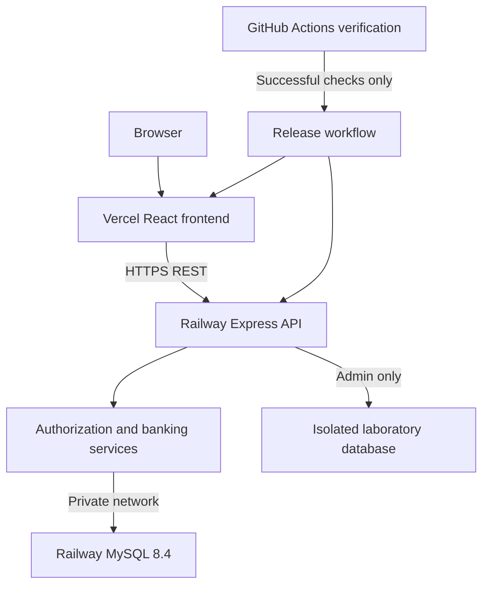

# NEXBANK architecture — Phase 1

Educational banking simulation. No real funds, card details, or payment gateway.

## Scope and stack

React/TypeScript/Vite supplies a responsive client; React Hook Form and Zod validate input. Express validates independently and authorizes every account operation. Prisma handles ordinary user queries; mysql2 executes transactional stored procedures and laboratory sessions. MySQL 8.4/InnoDB is authoritative. Argon2id protects passwords. Access JWTs are short-lived, refresh tokens are opaque, hashed and rotated in MySQL. Pino logs operational failures without credentials.

## Financial invariants

Store INR amounts as BIGINT paise and pass decimal strings over JSON. Never compute money with JavaScript floating point. Customer accounts cannot go negative. A system equity account offsets controlled simulated grants. Each posting contains exactly two ledger lines summing to zero. Customer balances are projections updated in the same transaction as immutable ledger entries. A reconciliation query compares each balance to its ledger sum.

The transfer procedure owns START TRANSACTION, locking, validation, debit, credit, ledger insertion, idempotency result and COMMIT. Express owns authentication, request shape, ownership context and bounded whole-procedure retries on deadlock/lock-timeout. SQL repeats critical authorization and status checks under locks. Account rows lock by ascending id. User rows lock by ascending id first so suspension cannot race a transfer.

Idempotency is scoped to authenticated user and key. A request hash detects key reuse with different payloads. The idempotency row is created inside the same transaction; a rollback leaves no successful result. Duplicate completed requests return the original reference. Failed attempts are recorded separately from committed financial transactions, after rollback.

## Risks and resolutions

- Initial money must not appear without a ledger counterparty: a system equity account backs grants; only admins can issue controlled adjustments.
- Views do not grant per-user authorization: API ownership filters remain mandatory.
- Cross-site Railway refresh cookies may be blocked: production frontend uses a same-origin /api proxy to Railway. Cookies stay HttpOnly, Secure and SameSite=Lax. Exact Origin checks protect mutations.
- Deployment is not atomic across two hosts: use backward-compatible APIs and expand-only migrations; health-check backend before frontend promotion. Destructive migrations require a separate maintenance plan.
- Labs could corrupt data: dedicated database name ending \_lab, separate URL, explicit lab enable flag, and no production-table references. Production deployments disable lab execution by default.
- Granting root credentials to runtime bypasses protections: use separate migration, runtime and laboratory users. Runtime receives procedure EXECUTE, restricted column updates and read rights, never ledger UPDATE/DELETE.
- A passed frontend build does not prove banking correctness: release requires real MySQL integration tests.

## Module layout

frontend/src: pages, forms, API and protected navigation.
backend/src: routes, controllers, services, repositories, database, middleware, validation, utilities.
database/migrations: ordered SQL with tables, routines, views and triggers.
docs: architecture, schema, API, security, tests, deployment, viva.
.github/workflows: verification and gated release.

## Roadmap

1. Finalize architecture, normalized schema and API contract.
2. Implement MySQL schema and single posting procedure; verify with MySQL.
3. Implement auth, accounts, beneficiaries, statements and admin APIs.
4. Build responsive React user/admin screens.
5. Add isolated executable DB laboratory.
6. Run unit, integration and browser checks; repair failures.
7. Package docs, publish source, provision hosting, configure secrets and release gates, verify public flows.

No phase is marked verified merely because files exist.
