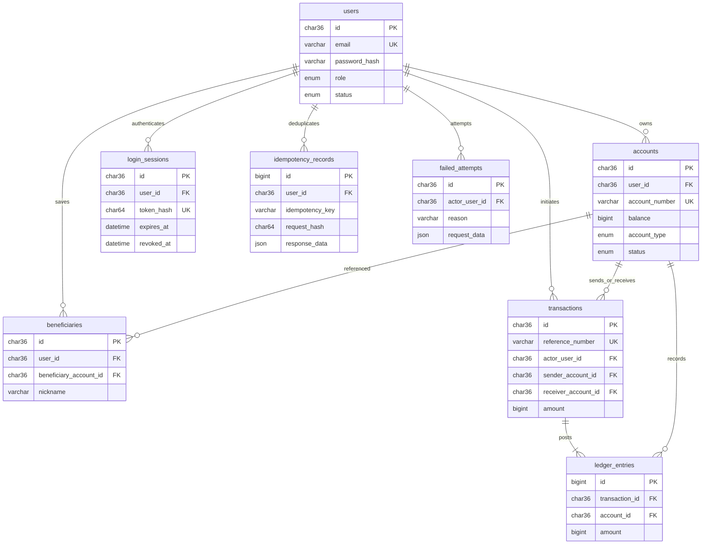

# Relational design

The executable schema is in database/migrations/001_core.sql and 002_procedures.sql. SQL migrations are authoritative; there is no ORM, all access goes through mysql2.

Audit logs additionally store actor_user_id, action, table_name, record_id, OLD/NEW JSON and UTC creation time. Actor is an audit snapshot identifier, deliberately without a cascading relationship. Financial FKs use restrictive deletion. No user deletion endpoint exists. Beneficiaries are ordinary removable preferences; financial records cannot be deleted through the API.

## Normalization

1NF: scalar columns contain one value; users do not store lists of accounts or beneficiaries. Audit JSON stores historical snapshots, not active relational entities.
2NF: each non-key field depends on the entire primary key. Ledger uniqueness additionally covers (transaction_id, account_id); idempotency uniqueness covers (user_id, idempotency_key).
3NF: users hold identity; accounts reference users; ledger entries reference accounts and transactions. Names and email are not repeated in financial rows. The balance column is intentional denormalization: a transactionally maintained projection of SUM(ledger_entries.amount). Reconciliation detects divergence.

## Money and journal semantics

BIGINT holds exact paise. A positive ledger amount increases a customer's claim; a negative amount decreases it. Treasury equity may be negative to offset simulated issuance. Internal transfers preserve the sum of all balances. All JSON financial values are strings. Charts alone convert to Number for approximate visual display; postings never do.

Only the posting procedure writes ledger entries in the runtime privilege model. It inserts exactly two equal-and-opposite entries. CHECK constraints cannot enforce cross-row balancing in MySQL, so procedure-only write access plus reconciliation enforce that invariant. Immutable triggers prevent editing or deleting posted entries and transactions. They do not produce ledger entries.

## Indexes

Unique email, account number and reference indexes support direct lookups. Composite (sender_account_id,created_at), (receiver_account_id,created_at), (account_id,created_at) indexes support activity access. Additional timestamp indexes serve admin queries. Every index adds write and storage cost; use the isolated indexing lab to measure query plans rather than inventing performance numbers.

## SQL/application boundary

Backend: authenticate, parse strings, enforce request bounds, create a canonical request hash, map errors, retry complete procedure calls only for deadlocks/timeouts.
SQL: lock owners and accounts, enforce live statuses and sender ownership, check balance, debit, credit, post journal, store idempotency response, commit or rollback.

The controlled-adjustment procedure delegates to transfer_funds, avoiding a second independent posting implementation. Registration grants no balance. Seeding and admin simulated grants use the same procedure.
