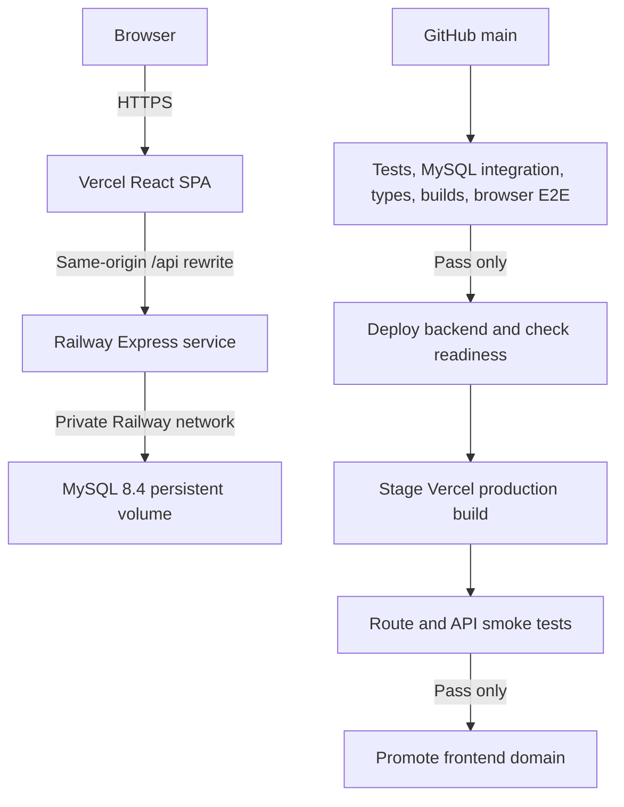

# GitHub, Railway and Vercel deployment

## Recorded state — 10 November 2026

Source is published at https://github.com/KulishDadhich/NEXBANK-ADBMS. See TESTING.md for CI evidence. No application or production database has been deployed. Railway and Vercel authentication succeeded, but hosting projects, production variables, release tokens and live verification remain to be configured. Live website/API URLs do not exist yet.

## Deployment topology



## Get the published project — Windows PowerShell

Install Git and Node.js 22. Clone the existing repository to retain its complete commit history:

```powershell
git clone https://github.com/KulishDadhich/NEXBANK-ADBMS.git
cd NEXBANK-ADBMS
npm ci
```

For an existing clone, commit or stash your own edits before `git pull --ff-only`. The downloadable ZIP contains source files; it does not contain a hidden .git directory or dependency/build folders. Follow README.md for database setup and running both servers.

Never add .env files, database dumps, credentials, .vercel state or private keys. Review `git diff --cached` before committing. The CI path check is not a comprehensive secret scanner.

## Railway

1. Create a project NEXBANK and a production environment. Confirm the available Railway plan/credits first; hosting is not guaranteed to remain free. Local Docker does not need a paid service.
2. Add a MySQL service using mysql:8.4 with a persistent volume mounted at /var/lib/mysql. Generate a unique root password directly in Railway. Do not create a public TCP proxy for ordinary production access. Set MYSQL_DATABASE=nexbank and TZ=UTC.
3. Create an API service from this monorepo with repository root as build context. Use backend/Dockerfile and railway.toml. Disable direct Git push deployments; the CI job is the only release path. Do not let an unverified push trigger deployment independently.
4. Configure backend variables in Railway, never in Vercel's VITE\_\* variables:

| Variable               | Value                                             |
| ---------------------- | ------------------------------------------------- |
| NODE_ENV               | production                                        |
| PORT                   | Railway-provided port or 4000                     |
| DATABASE_URL           | restricted runtime user on MySQL private hostname |
| MIGRATION_DATABASE_URL | migration credential on same private database     |
| JWT_SECRET             | at least 32 random bytes, generated privately     |
| FRONTEND_ORIGINS       | exact https:// production frontend origin         |
| LAB_ENABLED            | false                                             |
| SEED_DEMO              | false                                             |

5. For first provisioning, run migrations and the seed from a Railway-connected execution environment. Supply ADMIN_EMAIL and a unique ADMIN_PASSWORD privately for seeding; remove ADMIN_PASSWORD after seeding. Run scripts/provision-users.mjs with MIGRATION_DATABASE_URL and RUNTIME_DB_PASSWORD. Then set DATABASE_URL to nexbank_runtime with that password. The first bootstrap is deliberately a provisioning step; do not publish an API using the root credential as its runtime identity.
6. Railway pre-deploy runs the migration runner. MySQL DDL auto-commits; a failed partial migration needs manual inspection/repair, not a blind restart. Applied migration checksums are immutable. Use additive migrations for live changes.
7. Generate the API HTTPS domain, record it as BACKEND_URL and check /health/ready. Railway's healthcheck prevents a failed startup from becoming the active deployment.
8. Enable volume backups in the hosting plan if available. Never treat a persistent volume as a backup.

MySQL private networking avoids public exposure. If an external DB connection is necessary, require verified TLS and provide DB_SSL_CA; never use rejectUnauthorized=false. Keep the migration credential separate from the ordinary runtime URL. A stronger production separation runs migrations as a one-off job so the running API container does not retain a DDL credential.

## Vercel

Authorize the connected app for the intended team. Create a Vite project with frontend as its root directory and dist as output. The checked-in vercel.json disables Git auto-deploys. Do not enable a parallel push-to-production integration.

Set BACKEND_URL locally/CI to the actual Railway HTTPS origin and run:

```powershell
$env:BACKEND_URL="https://YOUR-SERVICE.up.railway.app"
node scripts/configure-vercel.mjs
```

This replaces the explicitly nonfunctional proxy placeholder. No database credentials are used by frontend builds. /api paths proxy to Railway; browser routes rewrite to index.html. Same-origin cookies avoid depending on third-party Railway cookies. Keep FRONTEND_ORIGINS aligned with the final public frontend URL. If testing login on a staged URL, temporarily allow that exact staged origin; do not allow arbitrary preview origins.

## GitHub Actions and release gates

The workflow .github/workflows/ci.yml runs backend unit tests, frontend component tests, TypeScript checks, real MySQL 8.4 integration tests, production builds and Playwright E2E against an isolated CI database. CI passwords are disposable test-only values, not production secrets.

Configure a production GitHub environment restricted to main; set required reviewers where appropriate. Protect main with the verify job as a required check. Store tokens directly in GitHub environment secrets; never paste them into source or chat.

Secrets: RAILWAY_TOKEN (project-scoped), VERCEL_TOKEN, and VERCEL_AUTOMATION_BYPASS_SECRET when deployment protection is enabled.
Variables: RAILWAY_PROJECT_ID, RAILWAY_SERVICE_ID, RAILWAY_ENVIRONMENT_ID, VERCEL_ORG_ID, VERCEL_PROJECT_ID, BACKEND_URL. Set RELEASE_ENABLED=true only after target IDs, permissions, provisioned schema, runtime grants and health checks are confirmed.

The deploy job has needs: verify and only runs on main. It uploads the exact checked-out verified revision to Railway, waits for readiness with a matching commit revision (so an old healthy instance cannot satisfy the check), stages a production Vercel build without assigning domains, checks SPA refresh routes and the protected API proxy, then promotes that build. Failed verification cannot enter the release job. Failed frontend smoke tests cannot promote it. The verification pipeline runs on GitHub. Hosting-side settings are not configured, so deployment remains disabled. CI pins Ubuntu 24.04 because the locked Playwright version does not support Ubuntu 26.04.

Cross-host release is not atomic: a healthy new backend may become live before frontend staging fails. Keep APIs backward-compatible; rollback backend and frontend independently to the recorded prior successful deployments. Database migrations must remain compatible with both versions.

## Final verification record

After deployment record actual URLs and commit SHA in PROJECT_STATUS.md. Verify landing page, registration, login, refresh, account creation, beneficiary editing, authorized transfer and statement download, admin controls and database reconciliation. Registration creates zero-balance accounts; use a controlled admin simulated grant for the transfer demonstration. Never run rollback injections, concurrency/deadlock or destructive tests on the ordinary production database. Those belong in CI/local \_test and \_lab databases.

The deployment smoke script checks routing and API reachability; it does not claim to prove all banking flows. Full browser/financial verification must be recorded separately.
